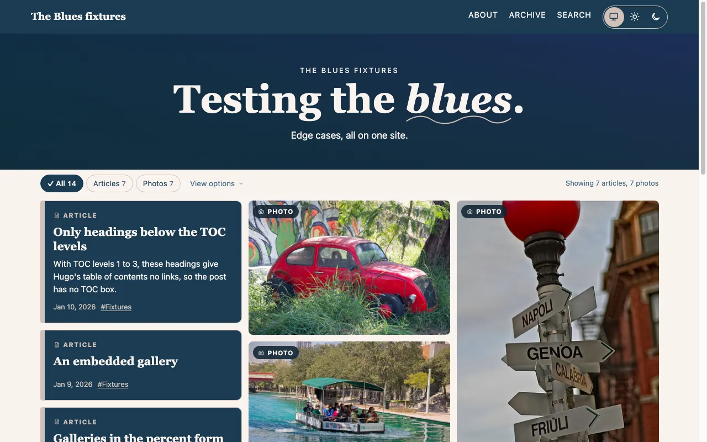
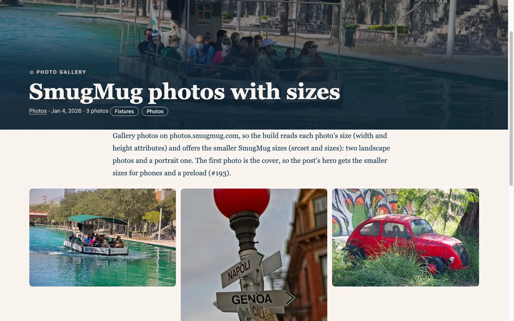
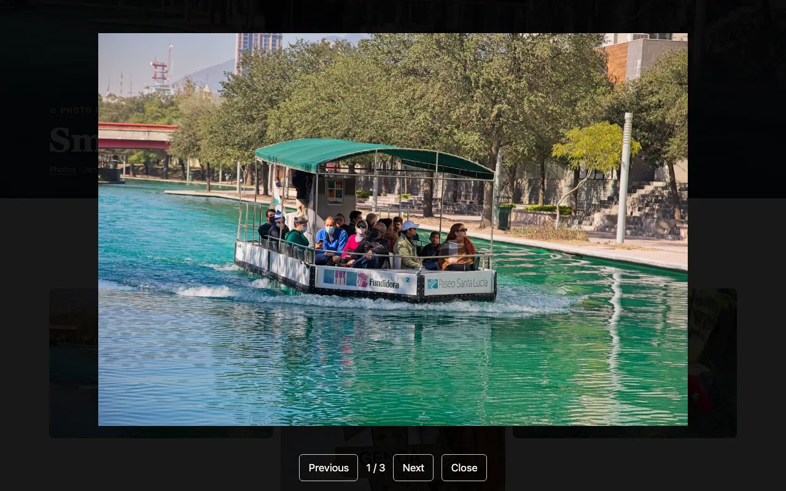
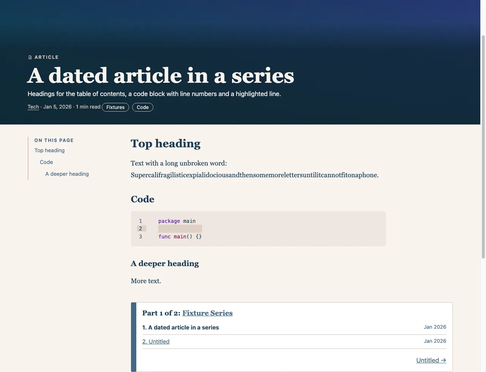
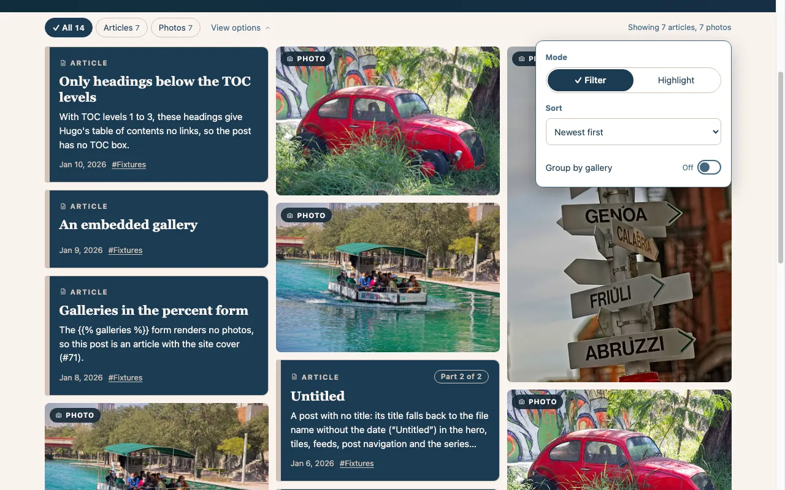
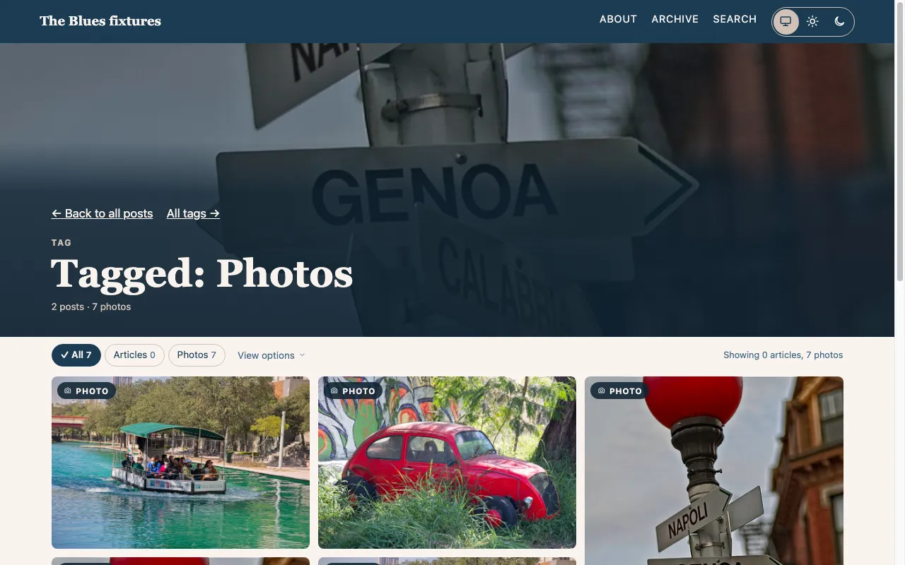
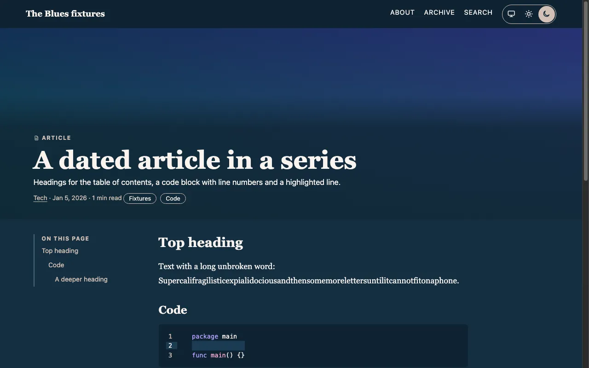
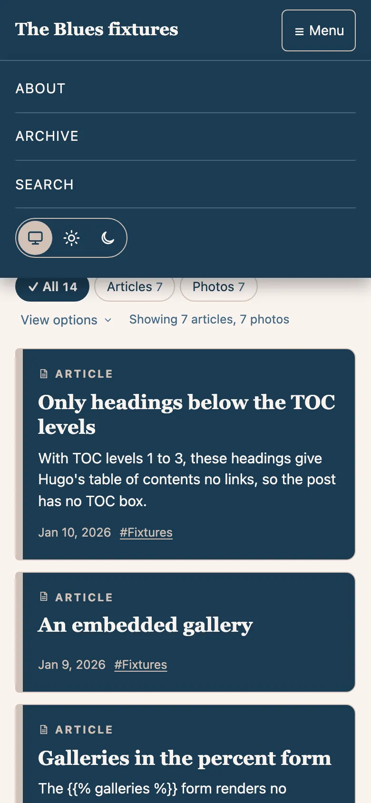

# The Blues

A responsive, accessible Hugo theme for [guyheckman.me](https://guyheckman.me). Replaces the Clean White theme.
Palette: navy `#1B3C53`, steel blue `#456882`, sand `#D2C1B6`, cream `#F9F3EF`, with light and dark modes. The mode
follows the system setting (`prefers-color-scheme`) unless the reader picks Light or Dark with the switch in the nav.

It has a hero with a wavy-underlined slogan, a full-width masonry wall (three columns from 900 px) that mixes photo tiles and
article tiles, a calm "View options" popover (filter or highlight by type, sort, group by gallery), photo posts with a masonry
gallery and a `<dialog>` lightbox, articles with a table of contents and series box, tag pages, and serif headlines. It builds
the site's real content with no Hugo warnings, and at the switch from Clean White it produced the same 30 URLs. See "Known
limits" below and the [open issues](https://github.com/cyvaquero/hugo-theme-theblues/issues).

<picture>
  <source media="(prefers-color-scheme: dark)" srcset="images/readme-home-dark.webp">
  
</picture>

The home wall, in the mode that matches your GitHub theme (on a site it follows the reader's system, or the switch in
the nav). More views, all from the exampleSite fixture:

- <br>
  A photo post with its masonry gallery.
- <br>
  The `<dialog>` lightbox.
- <br>
  An article with the table of contents and the series box.
- <br>
  The wall's "View options" popover.
- <br>
  A tag page with its hero and wall.
- <br>
  The color theme switch, set to Dark.
- <br>
  The hamburger menu at phone width.

How the images were made is in [docs/testing.md](docs/testing.md).

## Requirements

- Hugo **0.163.3** or later (standard or extended). Earlier versions have published Hugo security advisories, and the theme
  uses `.Language.Locale`. Developed and tested on 0.168.0. The minimum is set in the theme's `hugo.toml`
  (`[module.hugoVersion] min`), which Hugo checks and warns about; `theme.toml`'s `min_version` only mirrors it for the
  themes gallery. Before relying on a newer Hugo, run the checks under "Upgrading Hugo".
- No Node, no Sass: CSS and JS go through Hugo Pipes (minify and fingerprint).
- **Browsers:** the current and previous major versions of Chrome, Edge, Firefox and Safari, on desktop and mobile.
  The oldest versions with everything working are Chrome and Edge 108, Firefox 121 and Safari 16.4, going by
  the CSS features the theme uses (`:has()`, range media queries, `dvh` units); they are not tested in those
  versions. Below them
  the pages still work, with less polish:
  - before Firefox 121 (no `:has()`), a focused wall tile and a focused code block get the browser's ring on the
    link or the `<pre>` instead of one around the whole tile or block, and a focused gallery thumbnail gets a ring
    drawn inside its edge (steel with a sand line inside it) instead of outside it;
  - before Chrome and Edge 104 and Safari 16.4 (no range media queries), a SmugMug hero always loads its full-size
    image instead of the smaller size for the screen;
  - before Chrome and Edge 108, Firefox 101 and Safari 15.4 (no `dvh` units), the lightbox sizes to `vh`, so on a phone
    the browser's toolbar can cover part of the photo.
- **CSS is hand-written**: `assets/css/main.css` holds every style, commented and readable, with no framework, no
  `@import`, and no third-party or legacy stylesheets. The only other stylesheet, `assets/css/nojs.css`, is a few lines
  loaded inside `<noscript>` that show the nav links when the hamburger menu can't work. Hugo minifies and fingerprints
  both at build time
  (`layouts/_partials/asset.html`): a production build (`hugo`) publishes `css/main.min.<hash>.css` with the comments
  stripped, while a development build (`hugo server`) serves the readable source unchanged. The JavaScript files follow the
  same rule.
- No external fonts, frameworks, or CDN scripts, and no inline scripts. JavaScript is seven small files:
  - `theme.js` (in `<head>`, not deferred, so a picked mode applies before the first paint) and `menu.js`, on every
    page;
  - `wall.js`, `gallery.js` and `search.js`, only where needed (`search.js` on the search page and the 404 page, and only when
    the site publishes the search index; see "Search");
  - `analytics.js`, only when the site sets a GA ID, and only in production builds. It has no consent step (see
    `[services.googleAnalytics] id` under "Site settings it reads");
  - `comments.js`, on posts when the site sets a Disqus shortname.

  A site CSP therefore needs no script hashes. Hugo's internal GA and Disqus templates are not used. `wall.js`,
  `comments.js`, `gallery.js` and `search.js` hold the text they write (captions, comment messages, lightbox labels, result
  counts) as a Go template
  action, which Hugo fills in from the site's language when it builds them (see "Translating the theme"); a site's own
  copy of a script is run as a template only if its first line is the template comment `{{- /* theblues:template */ -}}`,
  which renders as nothing (any other `{{` in a script is published as written); a site's copy of one of these four
  needs that line, and the build fails naming a script that calls `js-text.html` without it.

## Installation

Add the theme as a Git submodule and select it in the site config:

```bash
git submodule add https://github.com/cyvaquero/hugo-theme-theblues.git themes/hugo-theme-theblues
```

```toml
theme = "hugo-theme-theblues"
```

Pin the submodule to a release tag (for example `1.3.0`). The theme is not packaged as a Hugo Module (there is no
`go.mod`), and its release tags have no `v` prefix, which Go and Hugo Modules don't recognize as versions. So a site that
imports the theme as a module, like the Hugo themes gallery, gets the tip of the default branch, not a release. To use a
release, add the theme as a submodule and pin the tag.

The footer shows the Hugo version and the theme version. The theme version lives in `data/theblues.toml`; bump it
with every CHANGELOG version. A site can override it with its own `data/theblues.toml`.

## Content structure

The templates assume this layout; other structures are not supported yet.

- **Posts live in the site's main sections**, `content/post/` by convention. The home wall, section and term walls, the
  archive, post navigation and the home feed list only pages in Hugo's `mainSections`. Set it in the site config:

  ```toml
  mainSections = ["post"]
  ```

  Without it, Hugo uses the one section with the most pages, which may not be the posts. `layouts/post/page.html` is
  the post template; it applies to the `post` section, and a site with posts in another main section gives them the
  `post` type, for example `[[cascade]] type = "post"` with `[cascade.target] path = "/notes/**"`. Pages that don't use
  the post template get no series box, comments, previous/next links or table of contents. Taxonomy indexes (`/tags/`
  and so on) count posts only and leave out terms used only outside the main sections; a term page with no posts says
  "No posts yet."
- **Taxonomies:** declare `series` next to the default ones. A series lists its posts oldest first; give posts a
  `weight` in their front matter to set the order instead (lowest first; posts without one follow, oldest first):

  ```toml
  [taxonomies]
    category = "categories"
    tag = "tags"
    series = "series"
  ```

- **Archive:** a page with `layout: archive` in its front matter (for example `content/archive/index.md`) lists every post by
  year.
- **Search:** `content/search/_index.md` uses `layouts/search/section.html`. It searches the site once the site
  publishes the search index (see "Search"); until then the page is published (and listed in the sitemap) with the text
  "Search is not available yet." The nav link appears only when `params.search_enabled` is set.
- **Syntax highlighting:** set `[markup.highlight] noClasses = false`. Hugo then marks code with Chroma classes, and the
  theme colors them from its `--sx-*` tokens: the modus-operandi colors in light mode and modus-vivendi in dark, on the
  theme's code background, all 4.8:1 or more. The `style` setting is then unused. With Hugo's default inline highlighting
  (`noClasses = true`) the chosen style's own colors show instead, so code blocks keep them in both modes.
  **Line numbers** (`lineNos = true` or `linenos=true` on a block) meet contrast only with `noClasses = false`.
  Inline styles carry no classes the theme can target, and Chroma's styles draw line numbers in a low-contrast gray,
  `#7f7f7f` in most (for example `github`, `modus-operandi`, `monokai`): 4.0:1 on white and 3.18:1 on a highlighted
  line in light styles, 3.71:1 and 2.74:1 in the default `monokai`, and about 2.5:1 in `nord` and `gruvbox-light`,
  all below the 4.5:1 that WCAG 1.4.3 asks for.
- **Icons:** the theme ships a serif "g" monogram on navy, served from the site root:
  - `static/favicon.svg`, with the letter in the system serif;
  - `static/favicon.ico` (16, 32 and 48px);
  - `static/apple-touch-icon.png` (180px, square, since iOS rounds the corners).

  To use your own, put files with the same names in the site's `static/`, which takes precedence over the theme's. The
  `<meta name="theme-color">` is navy `#1B3C53` in light mode and `#0F2332` in dark, the nav band's colors (`--band`;
  a palette change updates both `main.css` and `head.html`, which point at each other).
- **Color theme switch:** the last item of the nav, inline from 821px and inside the hamburger menu below that. Three
  buttons, System (the default), Light and Dark, with `aria-pressed` on the current one. `theme.js` puts the
  class `js` on `<html>` (which `main.css` uses to keep the space of the controls that scripts show later: this switch and
  the wall controls), sets `data-theme="light"` or `"dark"` on `<html>`, keeps the choice in `localStorage` under `theme` (System removes it),
  updates `<meta name="color-scheme">` and both `theme-color` metas, keeps other open tabs in step, and reloads loaded
  Disqus comments so they match. Without JavaScript the switch is hidden and the mode follows the system.
- **Share image (`og:image`):** a page's own `image`, or the first photo the page shows from a `gallery` shortcode
  (photos Hugo doesn't render, inside an HTML comment or a `{}` block, don't count). Otherwise
  `params.og_image` if set, and otherwise the cover, which is the site's `header_image`.
- **Markdown links and images:** links and image sources are kept only for `http`, `https` and scheme-less paths (links
  also allow `mailto` and `tel`); a `javascript:`, `data:` or other URL renders the text with no link and the image with
  no `src`. A link to a page or a page resource resolves to its permalink, as with Hugo's built-in hooks; an image source
  resolves to a page resource or a file in the site's `assets/`. Links to another host, or to the site's host on another port (another origin), open in a new tab, and say so to
  screen readers as their description (`aria-describedby`, pointing at one hidden element, `id="tb-newtab"`, that every
  page holds), so a heading with such a link keeps a plain name in the heading list and the table of contents. A reference
  would replace a link's Markdown title as its description, so a titled link has no reference: its `title` ends with the
  same notice ("Title (opens in a new tab)"), which is then the one description, and also the tooltip. The feeds drop the
  reference from the items' links, since the hidden element is on the site's pages only. A port that is the scheme's default (443 for
  `https`, 80 for `http`) counts as no port, so `https://example.org:443/` is the site's own host, and the scheme isn't compared. A titled image is a `<figure>` with a caption only when it
  stands alone and the site sets `markup.goldmark.parser.wrapStandAloneImageWithinParagraph = false`; otherwise the title
  is the tooltip.

## Shortcodes

| Shortcode | Usage | Notes |
|---|---|---|
| `galleries` | ` … ` | Wraps `gallery` calls in a masonry block and loads the lightbox. Use the `` form; the `{}` form renders nothing, and its photos are not shown on walls or used as covers. Only the `gallery` photos are output; any other text or HTML between the tags is dropped. |
| `gallery` | `` | One photo. `src` is a SmugMug `X2` thumbnail URL; the link and the lightbox use the `X3` size. `src` may be named or the first positional argument, in `"…"` or `` `…` `` quotes. The positional form takes only `src`: Hugo doesn't allow adding `title=` to it, and a second positional argument is ignored, so such a photo gets the "Photo N" alt text. Photos inside an HTML comment are not counted, shown on walls or used as covers; inside a `galleries` block, comment a photo out with `` instead, because the shortcode still runs there. `title` becomes the photo's alt text (also read out on wall tiles); it isn't shown as a visible caption. Without a title the alt text is "Photo N" and the build warns (warning ID `theblues-gallery-no-title`). |
| `embed` | `` | A sandboxed iframe (URL, width, height, optional title; positional only), meant for SmugMug gallery embeds. The build fails if the URL, width or height is missing, the URL is not `https://host/…` (no user name, backslash or extra slash before the host), it is on the site's own host and port (the same origin, where the sandbox gives no protection; the site's host on another port is allowed, and a port that is the scheme's default counts as none; when the site's `baseURL` host is an IP address, any URL whose host is an IP address in any spelling, such as `2130706433`, `0x7f.1`, `127.1` or `[::ffff:127.0.0.1]`, is refused as well), its host or the site's `baseURL` host is not plain ASCII (write an internationalized name as punycode, `xn--…`, so the two can be compared), or the site's `baseURL` has no host to compare with. |

## Search

Search runs in the visitor's browser over one JSON file that the normal build writes. There is no search service, no key,
no step after the build and no dependency. The script's only request is for the index file, and it sends nothing
anywhere; but the query is kept in the address (`?q=`), so anything that records page addresses records it too, the theme's
optional Google Analytics loader among them (GA4's site search measurement reads `q` as the search term by default).

**Turning it on.** The theme defines an output format, `searchindex`, and a template for the search section. A site
publishes the index by listing the format in that section's outputs. Hugo doesn't merge a theme's `outputs` with the
site's, so the list names every format the section needs (an HTML page, and no feed):

```yaml
# content/search/_index.md
---
title: "Search"
outputs: [html, searchindex]
---
```

The same `outputs` can come from a `cascade` in the site config that targets `/search`. Set `params.search_enabled` to
show the SEARCH link in the nav. The build then writes `/search/index.json` (`/<language>/search/index.json` for a
language that has its own search section), at that address and not fingerprinted, so a site can cache or purge it by
name. A site that doesn't list the format gets no index and no script, and its search page keeps "Search is not
available yet."

**What is indexed.** Every regular page of the language except those with `search: false` in their front matter.
Drafts, future and expired pages are left out by Hugo's own rules. So is a page the build doesn't publish: one whose
`build.render` is `never` or `link` (it has no page at its address, or none is written there) is not indexed, even when
`build.list` is `always`. The sitemap follows the same rule. The file is `{"v":1,"p":[row, …]}`, and each row is a list:
`[title, url, date, section, tags, categories, series, description, photoTitles, text]`. `date` is `YYYY-MM-DD` (empty
for an undated page), `section` is the title of the page's top-level section (empty for a page in the site root),
`photoTitles` are the titles of its `gallery` photos, and `text` is the page's plain text with white space collapsed.
The text is cut to `params.search.textLimit` characters (default 5000; `0` keeps all of it). The `v` number is the
format's version: the script ignores an index whose version it doesn't know.

**Size.** Every visitor who searches downloads the whole file once. A build whose index is over 1 MB (1,048,576 bytes)
warns with the ID `theblues-search-size`, and `--panicOnWarning` stops it. Lower `textLimit`, or set `search: false` on
pages that need no search. Serve the file compressed (gzip or Brotli), as hosts do for other JSON, and the download is
a fraction of that.

**How it matches.** The query and the pages are folded to lower case and the optional marks are removed (`cafe` finds "Café", whether
the accent is one character or a letter plus a combining mark). The marks removed are the accents of Latin, Greek and
Cyrillic (U+0300 to U+036F), the Arabic vowel marks (U+064B to U+065F and U+0670), and the
Hebrew points and cantillation marks (U+0591 to U+05BD, U+05BF, U+05C1, U+05C2, U+05C4, U+05C5 and U+05C7). Every other
mark stays, because it tells words apart: the vowel signs, virama and nukta of Devanagari and other Indic scripts, and
the vowels and tone marks of Thai, are part of the word. Every word of
the query must match a word of the page, exactly or as its start (`bost` finds "Boston"). Pages are ranked by where the
words are: title 10, tags, categories and series 6, description 4, photo titles 3, text 1, newest first on a tie. If no
page has every word, the search allows one typo (an extra, missing, wrong or swapped letter) in words of four letters
or more, and if that finds nothing it lists the pages that have any of the words, the most words first. Words are split
at anything that isn't a letter, a digit or a combining mark, so a language written without spaces (Chinese, Japanese, Thai) is matched
by the start of each run of characters only. There is no stemming, no phrase search and no stop words. A query uses its first 10 different words, each cut to 64
characters; words over 64 characters in a page aren't indexed, and a `?q=` address is cut to 200 characters. Those lengths, and the four-letter minimum for a typo, count UTF-16 code
units, not letters as a reader sees them, so a combining mark counts as a letter: a Devanagari or Thai word of three visible letters
can already get typo matching.

**Dates in results.** A result's date is formatted by the browser (`Intl.DateTimeFormat`, medium date style, in the page's
language), not by the site's `dateFormat`, so it can differ from the date on a tile, most for a custom `dateFormat` and for
languages such as Arabic, Japanese and Korean. The index holds the date as `YYYY-MM-DD` only.

**The page.** A labeled search field with a Search button; Enter submits it. Results appear as the visitor types, in a list
of links (title, date and section, and a snippet with the matching words in `<mark>`), and the count is said once in a
polite status when typing pauses ("3 results", or "No results for …"). The query is kept in the address as `?q=`, so a
result list can be shared or come back to with Back, and a page opened with `?q=` runs it at once. The index is fetched
the first time the field gets focus or a query is run, from the address in `data-index`, and only when that address is on
the site's own origin. Up to 50 results are shown. Without JavaScript the page keeps "Search is not available yet." The
results are built with `createElement` and `textContent`, never `innerHTML`.

**The 404 page.** It lists the latest five posts in its HTML, so it is useful without JavaScript. When the site publishes
the index, `search.js` also searches the words of the missing address and, if anything matches, shows up to five results
under "Were you looking for…" in place of that list, with the words in the search field (so the visitor can edit them and
press Enter, which goes to the search page with `?q=`) and the count in the polite status. It reads
`location.pathname`, drops the site's base path, numbers, one-letter words and common URL words (`post`, `page`, `tag`,
`category`, `index`, `html`, `php` and the like), keeps at most 8 words of 40 letters, and matches them as above, except that
the last pass, any word, uses only words of three letters or more and keeps only pages that score 3.2 or more (a start-of-word match in the description scores 3.2). With no words left, no match
or no index, the page shows the empty search field (when the index is there) and the latest posts. The page keeps its 404
status: nothing redirects. A site that doesn't publish the index gets the latest posts and no script.

**Colors.** Matches use the tokens `--mark-bg` and `--mark-fg`, 8.2:1 in light mode and 8.1:1 in dark, and are bold as
well, so a match isn't shown by color alone. In forced-colors mode they use the system `Mark` and `MarkText` colors.

## Extending from a site

A site can add its own page types without overriding theme files:

- **Templates:** a site's `layouts/<section>/page.html` or `section.html` renders inside the theme's `baseof.html`. It
  fills the `main` block, and can replace the default hero by defining the `header` block. The nav, footer, stylesheet
  and menu script still come from the theme. The theme's heroes (home, About-style, 404, posts, and tag, category and
  series pages) preload their photo from `<head>` (`<link rel="preload" as="image" fetchpriority="high">`, one per
  hero size with its `media` query when the hero has smaller SmugMug sizes). A `header` block of the site's own gets no preload unless
  it records its photo's URL with `{{ .Store.Set "theblues-hero" $url }}`. The theme's heroes all set
  theirs up through `layouts/_partials/hero-style.html`.
- **`<head>`:** `layouts/_partials/head-end.html` is empty and is included last in `<head>`. A site's own
  `layouts/_partials/head-end.html` replaces it, for example to add a stylesheet for its own sections.
- **Analytics:** `layouts/_partials/analytics-on.html` returns `true` when the page includes the theme's Google
  Analytics loader (`analytics.js`): a production build, `[services.googleAnalytics] id` set and
  `[privacy.googleAnalytics] disable` not set. It is `false` otherwise. It is decided per build, not per visitor: the
  loader still loads nothing for visitors who send Do Not Track or Global Privacy Control. `head.html` uses the same
  partial, so a site that shows an analytics notice only when analytics loads stays in step with the theme: `{{ if partial "analytics-on.html" . }}…{{ end }}`. Its name and result are kept
  stable; a change is called out in the CHANGELOG. `head.html` calls it with `partialCached`, so it answers once per
  build: a site's own copy of the partial must not depend on the page. Theme versions before 1.3.0 don't have it; a site that must build
  with them can check `templates.Exists "_partials/analytics-on.html"` first. The theme itself shows no notice and asks
  for no consent before it loads analytics (see `[services.googleAnalytics] id` under "Site settings it reads").
- **Styles:** the custom properties at the top of `assets/css/main.css` (section 1) are the colors and fonts a site's
  CSS should use, so it follows light and dark mode: `--bg`, `--text`, `--muted`, `--link`, `--focus`, `--band`, `--bt`,
  `--line` (decorative rules), `--ctl-line` (borders of controls: chips, the mode switch, selects, tag pills and pager links), `--surface`, `--code`, `--on-bg`, `--on-fg`, `--hv` (the sand accent for hover and focus on dark bands),
  `--mark-bg` and `--mark-fg` (the search matches), `--scrim` (the navy scrim over photos, as RGB channels: `rgb(var(--scrim) / .8)`), `--serif`, `--sans`, `--wide` and
  `--measure`. Their names are kept stable; a rename or removal is called out in the CHANGELOG.
  A site's own dark-mode colors should use the theme's two dark selectors, so they follow the switch as well as the
  system: `@media (prefers-color-scheme: dark) { :root:not([data-theme=light]) … }` and `:root[data-theme=dark] …`.
  The theme's own dark tokens are written out in both of those places, and the build checks that the two copies hold
  the same declarations (`layouts/_partials/dark-tokens-check.html`, once per build): if they differ, or only one is
  found, it warns with the ID `theblues-dark-tokens` naming the tokens, and `--panicOnWarning` fails the build. It reads
  the `assets/css/main.css` the build uses, so a site that overrides the file with an edited copy is checked too; a
  stylesheet with neither block gets no warning. CSS `light-dark()` could replace the two copies. The
  current and previous major versions of every supported browser have it, but the oldest versions listed under
  Requirements don't (it needs Chrome and Edge 123, Firefox 120 and Safari 17.5).
- **Breakpoints:** the layout changes at fixed widths, which a site's CSS can match. They are not settings:
  - 560px: masonry walls and `galleries` blocks go from one column to two;
  - 700px: the View options popover becomes a 20rem panel at the right instead of spanning the controls, and the wall
    caption moves from the left to the right;
  - 821px: the full nav replaces the Menu button (`nojs.css` and `menu.js` use 820px and narrower), and articles get the
    table of contents beside the text;
  - 900px: masonry walls and `galleries` blocks get a third column.

## Translating the theme

The text the theme writes is in `i18n/en.toml`, and templates read it with Hugo's `T`: labels, headings, the wall's
caption and counts, the feed link, the comment and lightbox messages, the page-number text, and the three date layouts. English is the
default: text a site's language has no entry for is shown in English. Month and day names in dates follow the site's
language (the theme formats dates with `time.Format`), except that every English site gets US English names. Hugo has no
abbreviated month or weekday name for some locales (in Hugo 0.167.0, Arabic, Japanese and Korean: `Jan` and `Mon` come out
empty), so for them the theme writes the full name where a layout asks for `Jan` or `Mon`; a translation can also set its
own layouts (`exampleSite/i18n/ar.toml` does). To
translate the theme, or reword its English, for a site:

1. Copy the theme's `i18n/en.toml` to `i18n/<language>.toml` in the site, where `<language>` is the site's language code
   (`de`, `fr`, `pt-br`; the key under `[languages]`, or `defaultContentLanguage`). A site's entries replace the theme's
   one by one, so to reword the English a site's own `i18n/en.toml` needs only the entries it changes.
2. Translate the `other = "…"` values and keep the entry names and the placeholders in them (`{{ .n }}`, `{{ .part }}`,
   `{articles}` and so on). An entry with `one` and `other` is a count: `{{ .Count }}` is the number, and the language's
   plural rules pick the form. Write plain text, which the theme escapes; only `commentsHosted` is HTML.
3. An entry missing from a language's file is shown in the default language's text and, when that has none either, in
   the theme's English (`layouts/_partials/t.html`), so a partial translation still has every label.
   `hugo --printI18nWarnings` lists the missing entries. A language with no file at all uses the default language's
   file; when the default language is not English and has no file, the labels are all English and the build warns
   (`theblues-i18n`). Where the English text becomes the content of an element (a label, a heading, a button, a link
   name), the theme wraps it in `<span lang="en">`, so a screen reader reads it with an English voice (WCAG 3.1.2). Where
   it would become an attribute value (`aria-label`, `title`, `alt`), the page `<title>`, an `<option>`, a feed, a date
   layout or the "Undated" text, or text a script writes (captions, counts, the lightbox and comment messages), no
   markup can carry the language, so a reader hears it in the page's language. Translate those entries for a complete
   experience.
4. Set the site's `locale` (for example `de-DE`), which also sets `<html lang>`. The three date entries are Go layouts
   (`dateFormat` for dates on posts, tiles and wall headings unless `params.dateFormat` is set, `dateFormatDay` for the
   archive, `dateFormatMonth` for the series box), so a translation can reorder day, month and year. Month names come from
   Hugo's locale data, except on an English site (language `en` or `en-*`), which gets US English names whatever its
   `locale`: `en-GB` writes September as "Sep", not "Sept".
5. For a right-to-left language, set `direction = "rtl"` on it (`[languages.ar]`), and the theme writes `dir="rtl"` on `<html>`,
   so browsers, screen readers and the text itself run right to left. Left-to-right sites get no `dir`
   attribute. The layout is **not mirrored yet**: `main.css` still uses physical `left` and `right` properties, so
   the bars, indents, drop-downs and alignment keep their left-to-right sides. Mirroring them with CSS logical
   properties is tracked in the project's issues.

The scripts get their text the same way, through `layouts/_partials/js-text.html`: `wall.js`, `comments.js`,
`gallery.js` and `search.js` are built from `assets/js` as templates, so the HTML is the same for every language and a site with more
than one language gets a script per language (`js/wall.de.js`). The wall's group headings take their dates from the tile
captions the server wrote, so they are localized too. A count in a script has every plural form the language's entry
defines (`zero`, `one`, `two`, `few`, `many`, `other`, whichever the language's rules use): the script file holds the
entry's text for a list of sample numbers, and the browser's plural rules (`Intl.PluralRules`) pick the sample that has
the count's plural category, falling back to `other`. A language with just `one` and `other` gets the two texts as before.

What the theme leaves as it is: text that comes from the site (menu names, `slogan`, `tagline`, `title_404`,
`search_label`, content, and the titles of the tag, category and series index pages, which Hugo takes from the taxonomy
name unless `content/tags/_index.md` and the like set a `title`); the link names RSS, LinkedIn and GitHub; the "©" and the
year of the footer line when the site sets no `copyright`; and the messages of build warnings and errors, which are for
the person building the site.

## Known limits

- The wall is paginated **by tile**, 24 per page (`params.wall.tilesPerPage`). The type chips count the whole list, but
  filtering, the caption (which starts "This page:" when the list has more than one page), sorting and group-by work on
  the tiles of the current page, and a gallery can be split across two pages; its "Group by gallery" heading still counts all its photos.
  Hugo's `.Paginate` only accepts a collection of pages, so
  `layouts/_partials/wall-pager.html` paginates a stand-in collection with one entry per tile and slices the real tile list
  with the same offsets; page counts and URLs come from Hugo's own pager. It is a workaround. `pagination.pagerSize` does not
  affect wall pages.
  `tilesPerPage` and `photosPerGallery` must be whole numbers of 1 or more (text is read as a decimal number, so `"010"` is 10); anything else, including text that isn't a
  number, `true` or `false`, and a number with a fraction (`2.9`) or too big for a whole number (`1e30`), fails the build
  with a message naming the setting. The pager shows the first and last pages and two on
  each side of the current one.
- The series box lists every post of the series on each of its posts, so a series of N posts writes N x N list entries
  and its build time grows with the square of its length: about a second for a 150-post series. The theme is built and
  tested for series of up to about 25 posts; a much longer series still works, only the build takes longer.
- Wall pages after the first (`/page/2/`, …) have their own title ("guyheckman.me – Page 2", "Hugo – Page 2 |
  guyheckman.me"), but use page 1's canonical URL (`<link rel="canonical">` and `og:url`) and have no `rel=prev/next` in the
  head. The pager links carry `rel=prev` and `rel=next`. This is deliberate. The wall paginates by tile, newest
  first, so a later page is a shifting slice of one feed: adding a post moves every tile down a slot and tiles cross
  from page to page, so `/page/2/` shows different tiles from one build to the next. Page 1 is the stable entry point, and
  nothing is hidden behind the pager: every post is reachable, and indexable, at its own permalink, which the sitemap lists
  (Hugo's sitemap holds pages, not the pager's `/page/N/` URLs), and its tile links to it. The archive page
  (`layout: archive`, see Archive above) lists every post, with no pager, and each post links to the one before and after it.
  This departs from Google's current guidance, that each page of a paginated list be its own canonical
  ([pagination and incremental page loading](https://developers.google.com/search/docs/specialty/ecommerce/pagination-and-incremental-page-loading));
  Google says it no longer uses `rel=prev/next`. The cost is that a post is found through its permalink, the sitemap or the
  archive rather than through a later pager page. A site that wants each pager page to be its own canonical has no setting
  for it: it replaces `layouts/_partials/head.html` with a copy in which the `.Permalink` of the `<link rel="canonical">`
  and of `og:url` becomes the pager's URL when the page number is above 1, for example
  `{{ with .Store.Get "wall" }}{{ with .pag }}{{ if gt .PageNumber 1 }}{{ .URL | absURL }}{{ end }}{{ end }}{{ end }}`
  (`.Store.Get "wall"` is empty on pages that are not walls), and keeps that copy up to date through theme upgrades.
- A post without a `date` is shown as "Undated" (header, tiles, archive, series box), sorts last on the wall (first with Oldest first), has no  `pubDate` in feeds, and the build warns.
- Heroes and photo tiles set their image through a `style="--hi:url(…)"` attribute, so a site CSP still needs
  `style-src 'unsafe-inline'` (or `style-src-attr 'unsafe-inline'`); see "Content Security Policy" for the rest. The theme sets no page-level referrer policy (the `embed`
  shortcode's frames set their own, `strict-origin-when-cross-origin`); browsers default to that same policy, which a
  site can also send as a header.
- The 404 page lists the latest five posts (the main sections). Its search of the missing address runs in the browser, so
  the server's response is the usual 404 with that list; the matches replace it only for visitors with JavaScript.
- The 404 page and the `search` section get `<meta name="robots" content="noindex">`. To keep `/search/` out of the
  sitemap, a site sets `sitemap: {disable: true}` in `content/search/_index.md`. The theme provides its own
  `sitemap.xml` (`layouts/sitemap.xml`): Hugo's built-in template with one change, that a page whose `build.render` is
  `never` or `link` is left out, as it is from the search index, because no page is written at its address. A site can
  still replace it with its own `layouts/sitemap.xml`. The theme has no `robots.txt` template
  (use Hugo's `enableRobotsTXT`) and no JSON-LD.
- The theme's feed template (`layouts/rss.xml`, used for the home, section and term feeds) lists only pages in the main
  sections on the home feed and on each term's feed (tag, category, series; `mainSections`, see Content structure), the
  same pages as the term's wall. A section's feed lists the section's own pages. The `search` section still gets its own empty
  feed unless its `outputs` leave RSS out: `outputs: [html]`, or `outputs: [html, searchindex]` once the site publishes the
  search index (see Search), in `content/search/_index.md`.
- Feed links: every page with its own feed names it in `<head>`, and the footer links the home feed (`params.social.rss`).
  A "Subscribe via RSS" link (the `subscribeFeed` string) to the page's own feed is also in the header of each term
  page (tag, category, series) after the post and photo counts, in the header of each section page other than `search`,
  and in a post's series box under "Part N of M", for that series' feed. Home, the taxonomy indexes (`/tags/` and so
  on), About, Archive, Search and 404 have no such link. A page whose RSS output is turned off gets no link, and neither does a term
  with no pages in the main sections (its feed would be empty). In the series box, which can hold several links to different feeds, the link's name goes on
  after its visible text, "Subscribe via RSS: Series name", so the links of a post in two series differ for assistive
  technology. The link opens the feed as it is; the theme has no feed stylesheet.
- Search is a static file, so after a deploy a visitor whose browser or CDN kept the old `/search/index.json` searches
  the old pages until the copy expires; a host that sends `Cache-Control: no-cache` (or a short `max-age`) for that one
  file avoids it. The index holds one language's pages, so the search page of a language finds that language's pages
  only. See Search for how words are matched and what it leaves out.
- `photosPerGallery` applies per post: a post with several `galleries` blocks counts as one gallery.
- With Hugo's default inline highlighting, `.highlight` code blocks keep the style's own colors in dark mode; set
  `noClasses = false` to have them follow it (see Syntax highlighting).
- Reduced motion is handled (all transitions are gated on `prefers-reduced-motion`). Not yet checked on real devices: touch
  devices and screen readers. See Accessibility below.
- Build time grows with the number of posts and list pages: each list page (home, section, every term) builds its own
  tile list, once for all its pager pages. 550 posts built in about 0.5 s (median of 9 production, minified builds
  with a warm cache, Hugo 0.167.0, theme 1.3.27); times depend on the machine, so compare runs on your own.

## Site settings it reads

It keeps the parameter names the site already uses, so the site's `hugo.toml` (or `config.toml`) needs little change:

- `title`, `locale` (sets `<html lang>` and the language of month names; see Translating the theme), `mainSections` (the sections that hold posts, see Content structure)
- `params`: `header_image`, `slogan`, `tagline`, `description`, `SEOTitle`, `keyword`, `social.rss|linkedin|github`,
  `image_404`, `title_404`, `og_image` (share image for pages without their own), `search_enabled` (default off), `search_label` (default `SEARCH`, from the `searchLabel` entry of `i18n/en.toml`), `dateFormat` (a Go layout for
  dates on posts, tiles and wall headings, default `Jan 2, 2006`, from the `dateFormat` entry; the archive's `Jan 2` and
  the series box's `Jan 2006` are the `dateFormatDay` and `dateFormatMonth` entries), `showtoc` (site-wide default for
  the TOC; on when unset, and shown only when a post has headings within the `markup.tableOfContents` levels), the optional
  `[params.wall]` table: `tilesPerPage` (default 24) and `photosPerGallery` (default 4), each 1 or more, and the optional
  `[params.search]` table: `textLimit` (default 5000; the most characters of a page's text in the search index, `0` for
  all of it; it must be a whole number of 0 or more, like the `[params.wall]` settings: anything else, including text that
  isn't a number, `true` or `false`, a fraction (`2.9`), a number too big for a whole number (`1e30`) and a negative number,
  fails the build with a message naming the setting)
- Defaults for the hero and 404 texts: `slogan` is the site `title` when unset; `tagline` is `params.description` when
  unset; `title_404` is the theme's "Page not found" (the `pageNotFound` entry of `i18n/en.toml`, so it is translated
  with the rest). A post's front matter `subtitle` shows only in a post's own hero, where it falls back to the post's
  `description`; every other page's hero shows its `description` alone.
- `ignoreLogs`: the theme's build warnings have IDs a site can list there to silence them: `theblues-gallery-no-title`
  (a `gallery` photo without a `title`), `theblues-undated` (a post without a `date`), `theblues-addtional-menus`
  (the deprecated legacy menu, below), `theblues-image-size` (a wall or gallery photo URL that answers 404 or isn't an
  image), `theblues-insecure-photo` (a gallery photo, hero image or Markdown image whose URL starts with `http://` and isn't under the site's `baseURL`;
  see the photo size bullet under "How the wall works" in [docs/layout.md](docs/layout.md)), `theblues-toc-markup` (Hugo's table of contents markup
  changed, so the theme can't check or label it; better fixed than silenced) and `theblues-dark-tokens` (the two copies of the dark color
  tokens in `assets/css/main.css` differ; see Styles under Extending from a site) and `theblues-i18n` (the site's
  language has no theme text, so the labels are in English; see Translating the theme), for example
  `ignoreLogs = ['theblues-undated']`.
- `[[menus.main]]`, or the legacy `params.addtional_menus` list (Clean White's spelling) when no main menu is defined.
  The legacy list is deprecated: the build warns (`theblues-addtional-menus`), and it will be removed in a future major
  version.
  A `[[menus.main]]` entry whose `pageRef` doesn't resolve to a page is left out of the nav, so a link to a category
  or section appears only once it has content.
  From 821px the links are one row; when the menu, the site title and the theme switch don't fit (many items, or a
  large text size or zoom), the row wraps onto a second line, so every link and the switch stay reachable.
  Legacy `href` values that are full URLs are used as is; site paths get one trailing slash and follow a sub-path `baseURL`.
- `[[menus.footer]]` (optional): links shown in the footer under the social links, in a navigation landmark named
  "Footer", for example a privacy note (`url = "/about/#privacy"`) or a page (`pageRef`).
- `[services.googleAnalytics] id`:
  - Analytics loads only in production builds, unless `[privacy.googleAnalytics] disable = true`. A site can ask the
    theme whether it loads with `layouts/_partials/analytics-on.html` (see Extending from a site).
  - A visitor who sends Do Not Track or Global Privacy Control gets nothing: no gtag.js request and no hit.
  - **There is no consent step.** In a production build with a GA ID and `[privacy.googleAnalytics] disable` unset,
    Google Analytics loads as soon as a page is viewed, for every visitor who doesn't send Do Not Track or Global
    Privacy Control: the browser requests `gtag.js` from `www.googletagmanager.com` and Google Analytics records the
    visit. The theme has no consent banner, prompt or gate, and a visitor who sends neither signal has not agreed to
    anything. A site that needs consent (GDPR, the ePrivacy Directive) must gate or disable analytics itself: set
    `[privacy.googleAnalytics] disable = true` (or leave the GA ID out) and load Google Analytics from its own consent
    code, for example from `layouts/_partials/head-end.html`; or put its own `assets/js/analytics.js` in the site,
    which replaces the theme's and gets the ID as `data-id`, and have it wait for consent. Whether a site needs
    consent is for its owner to decide.
- `[services.disqus] shortname`: comments are click to load. Posts show a "Show comments" button, and nothing from Disqus
  loads before it is clicked. Builds for other environments (`hugo server`, `--environment staging`) show a note
  instead; analytics, likewise, loads only in production. A leading slash in the shortname is ignored. Optional front
  matter: `disqus_url`, `disqus_identifier`, `disqus_title`.
- Feeds (`layouts/rss.xml`, as in Hugo's built-in template):
  - `params.author` as a table with `email` and an optional `name` (`[params.author] name = "…" email = "…"`) fills
    the channel's `managingEditor` and `webMaster` and each item's `author`, which RSS requires to be an email
    address. A plain string, or a name without an email, adds nothing.
  - `copyright` becomes the channel's `copyright`, and the footer shows it as written (plain text, for example
    `copyright = "© 2023–2026 Jane Doe"`). Without it the footer shows "© <title> <current year>".
  - `[services.rss] limit` caps the number of items (no cap by default). Items are listed newest first by publish
    date, whatever a post's series `weight`, so the limit keeps the newest posts (the feed of a taxonomy's terms keeps
    Hugo's order).
- `[markup]`: the theme works with Hugo's defaults, and these settings change what it shows:
  - `[markup.highlight] noClasses = false` lets code follow the light and dark palette (see Syntax highlighting);
  - `[markup.tableOfContents] startLevel` and `endLevel` set which headings the "On this page" box lists, and a post
    with no headings in that range has no box;
  - `[markup.goldmark.parser] wrapStandAloneImageWithinParagraph = false` turns a titled image on its own line into a
    figure with a caption (see Markdown links and images).

  The `series` taxonomy also has to be declared by the site (see Taxonomies).
- Hugo's `[privacy]` settings: the theme loads Google Analytics and Disqus with its own scripts, not Hugo's internal
  templates, so only these apply:
  - `[privacy.googleAnalytics] disable = true` leaves analytics out (the way to switch it off for a site that needs
    consent before analytics loads);
  - `[privacy.disqus] disable = true` leaves the comments out (no button, no script);
  - `[privacy.googleAnalytics] respectDoNotTrack` has no effect: Do Not Track and Global Privacy Control are always
    honored. The other `privacy.googleAnalytics` settings are for Hugo's internal template and are ignored too.

`header_image`, `image` and `image_404` may be absolute URLs or paths under the site root (`img/x.jpg`); the theme turns paths
into absolute URLs.

Front matter: `title`, `subtitle`, `description`, `date`, `image` (the page's hero image and share image; without it the
hero uses the first gallery photo, then the site's `header_image`, see Share image), `showtoc`, `categories` (a list,
or a single string), `tags`, `series`. `hugo new content post/<name>.md` writes these from `archetypes/post.md`: the title
is the file name without a leading `YYYYMMDD-`, hyphens as spaces, title-cased (as the theme does for a post with no
title), the slug is the whole file name, and `showtoc` and `series` are there as commented lines to uncomment.

## Content Security Policy

The theme is written to run under a strict CSP: no inline scripts, no inline `<style>`, no `eval`, no `@import`, no
web fonts and no `data:` URLs. The origins a site's policy must allow are these, grouped by what needs them. Everything
else can stay at `default-src 'none'`.

**The theme itself**

| Directive | Value | Why |
|---|---|---|
| `script-src` | `'self'` | The theme's scripts are files on the site (`theme.js`, `menu.js`, `wall.js`, `gallery.js`, `search.js`, `comments.js`, `analytics.js`); there is nothing to hash. |
| `style-src` | `'self'` | `main.css`, and `nojs.css` inside `<noscript>`. |
| `style-src-attr` (or `style-src`) | `'unsafe-inline'` | Heroes and photo tiles set their image through a `style="--hi:url(…)"` attribute. This is only for `style=` attributes: the theme has no `<style>` element and its scripts set no styles. |
| `img-src` | `'self'` | The favicons and any local photo. A photo or hero on another host needs that host here too. |
| `connect-src` | `'self'` | The search index, which `search.js` fetches (`/search/index.json`), when the site publishes it. |
| `form-action` | `'self'` | The 404 page's search form, which goes to the search page, when the site publishes the search index. The search page itself runs its form in the browser, so `'none'` is enough for a site without the index. |
| `base-uri`, `object-src` | `'none'` | The theme uses neither. |
| `frame-ancestors` | `'none'` | Stops other sites from showing the pages in a frame (clickjacking). It works only in a header; see the notes below. |

**Optional services**, needed only when the site uses them:

| Service | Directive | Origins |
|---|---|---|
| SmugMug photos (gallery photos, hero sizes) | `img-src` | `https://photos.smugmug.com` |
| Google Analytics (`[services.googleAnalytics] id`, production builds) | `script-src` | `https://www.googletagmanager.com` (`gtag.js`) |
| | `connect-src` | `https://*.google-analytics.com https://*.google.com https://www.googletagmanager.com` |
| | `img-src` | `https://*.google-analytics.com https://www.googletagmanager.com` |
| Disqus (`[services.disqus] shortname`) | `script-src` | `https://<shortname>.disqus.com` (`embed.js`) and `https://c.disquscdn.com` |
| | `frame-src` | `https://disqus.com` |
| | `connect-src` | `https://links.services.disqus.com` |
| | `img-src` | `https://referrer.disqus.com https://c.disquscdn.com` |
| | `style-src` | `https://c.disquscdn.com` (its `realtime` stylesheet; blocking it only costs that styling) |
| `embed` shortcode | `frame-src` | the host of each embed's URL |
| YouTube, through `embed` or Hugo's `youtube` shortcode | `frame-src` | `https://www.youtube-nocookie.com` with `[privacy.youTube] privacyEnhanced = true`, else `https://www.youtube.com` |

The theme has no YouTube shortcode of its own; both ways above give an iframe, so a video needs `frame-src` only, and
Hugo's `youtube` shortcode needs the same `style-src-attr 'unsafe-inline'` as the theme.

An example for a site with SmugMug photos, Google Analytics and Disqus (`guyheckman-me` stands for the Disqus shortname):

```
default-src 'none'; script-src 'self' https://www.googletagmanager.com https://guyheckman-me.disqus.com https://c.disquscdn.com;
style-src 'self' https://c.disquscdn.com; style-src-attr 'unsafe-inline';
img-src 'self' https://photos.smugmug.com https://www.googletagmanager.com https://*.google-analytics.com https://referrer.disqus.com https://c.disquscdn.com;
connect-src 'self' https://www.googletagmanager.com https://*.google-analytics.com https://*.google.com https://links.services.disqus.com;
frame-src https://disqus.com https://www.youtube-nocookie.com; base-uri 'none'; form-action 'self'; object-src 'none';
frame-ancestors 'none'
```

Notes:

- **Send the policy as an HTTP header.** A `<meta http-equiv="Content-Security-Policy">` tag ignores
  `frame-ancestors`, `sandbox` and the reporting directives, so a policy in a `<meta>` tag leaves the pages open to
  being framed. Send it from the host or CDN instead, with the other security headers a page can't set itself:
  `Strict-Transport-Security`, `X-Content-Type-Options: nosniff` and, if you want a stricter one than the browser's
  default, `Referrer-Policy`.
- **Disqus loads more than it needs.** After "Show comments", Disqus's own script also tries a cleartext `http://cdn.viglink.com`
  pixel (VigLink) and LiveIntent (`d-code.liadm.com` script, `rp.liadm.com` requests, an `i.liadm.com` frame). The list
  above leaves them out on purpose: with the policy above they are blocked, the browser logs the violations, and the
  comments still load and show ("Comments loaded."). Allowing them lets those companies see your readers' visits. Disqus
  changes what it loads without notice, so expect to see violations from it in the console.
- **Google Analytics** loads only for a visitor who sends neither Do Not Track nor Global Privacy Control, so a browser
  with either signal never makes those requests. The origins are the ones Google documents for GA4 without advertising
  features (developers.google.com/tag-platform/security/guides/csp); with Google signals or ads features turned on,
  Google lists more (`https://*.g.doubleclick.net`, `https://*.google.<TLD>`, `https://pagead2.googlesyndication.com`
  and `frame-src https://www.googletagmanager.com`).
- Comments and analytics load only in production builds; a development build needs none of those origins.
- Checked with Hugo 0.167.0 and headless Chrome (CDP) on a production build of a copy of the exampleSite with a Google
  Analytics ID, the Disqus shortname above (reading an existing thread through `disqus_url`; nothing was posted),
  SmugMug photos and YouTube embeds, served with the example policy as an enforced header. The home page, a SmugMug hero,
  a gallery with the lightbox opened, the YouTube page and an article with comments loaded gave no violation from
  anything the theme loads or the lists above allow; the only violations were the VigLink pixel and the LiveIntent
  script. Without the Google, Disqus or YouTube origins, the same pages reported the violations for exactly those
  requests. In that test Chrome could not connect to `google-analytics.com`, so no analytics hit was recorded.

## Accessibility

The theme targets **WCAG 2.1 level AA**. That also covers the Revised Section 508 standards for web content, which
incorporate WCAG 2.0 AA (E205.4), and asks for more: WCAG 2.1 adds these criteria at levels A and AA,
which Section 508 doesn't require: Orientation (1.3.4), Identify Input Purpose (1.3.5), Reflow (1.4.10), Non-text Contrast (1.4.11),
Text Spacing (1.4.12), Content on Hover or Focus (1.4.13), Character Key Shortcuts (2.1.4), Pointer Gestures (2.5.1), Pointer
Cancellation (2.5.2), Label in Name (2.5.3), Motion Actuation (2.5.4) and Status Messages (4.1.3). The theme targets them too.
Section 508's software requirements (chapters 502 and 503) don't apply to web content that conforms to WCAG 2.0 AA
(the exception in 501.1). Its documentation requirements (chapter 602) do: this section is the theme's list of
accessibility and compatibility features (602.2), and the README, as electronic documentation, should itself conform
to WCAG 2.0 AA (602.3). The project's accessibility issues map review findings to both standards.

**Keyboard.** Everything works from the keyboard, with a 3px focus ring (steel on the page, sand on the navy band and
on photos):

- **Skip link:** "Skip to content" is the first stop and moves focus to the main content, and appears inset from the window corner
  with a sand ring, so the ring isn't cut off.
- **Nav:** at 820px and narrower, the Menu button (`aria-expanded`) opens the links; Escape closes the menu and returns
  focus to the button, and the menu also closes when focus leaves it. Without JavaScript the links show as a row.
- **Color theme switch:** three buttons, System, Light and Dark, in a group named "Color theme", with `aria-pressed`
  on the current one.
- **Wall controls:** the type chips are toggle buttons (`aria-pressed`). View options (`aria-expanded`) opens a popover
  and moves focus into it; Tab and Shift+Tab move between the button and the popover, and Escape, a click outside or
  moving focus away closes it (Escape returns focus to the button). Clear moves focus to the All chip; Reset closes the
  popover and returns to View options.
- **Photo tile captions:** a caption shows over the photo while the pointer or focus is on the tile; Escape hides it
  without moving either, and it comes back once the pointer and focus have left the tile and returned (WCAG 1.4.13).
  On touch screens the captions are always shown.
- **Lightbox:** Enter on a gallery photo opens a modal `<dialog>` named "Photo viewer" with focus on Close. Left and
  Right arrows, Home and End move between photos (also Previous and Next buttons, and swipe; a pinch zooms the photo and does not change it); Escape or Close returns
  focus to the photo that was opened. Modifier clicks still open the large image in a new tab.
- **Comments:** "Show comments" loads Disqus and moves focus to the "Comments" heading above them. A polite status
  announces "Loading comments…" and then "Comments loaded.", or, if Disqus is blocked or doesn't answer within 15
  seconds, "Comments couldn't be loaded…" with the button back as "Try again". After a timeout, "Try again" waits for the request already
  running instead of adding a second Disqus script; after a blocked or failed request it starts a new one.

**Search.** The field has a visible label, "Search this site", and Enter submits. The result count ("3 results", "No
results for …") is a polite `role="status"` that is on the page from the start and is said once typing pauses, not on
every key. Focus is never moved: not on load, not when results appear. Results are a list of links named by the page title,
with the date, section and snippet after the link, and matches are in `<mark>` (bold as well as colored). The field and the
button are at least 44px tall, and on touch screens (`pointer: coarse`) so are the result links; the page reflows to 320px.

On the 404 page the matches are a list of links under a heading ("Were you looking for…"), the count is said once in the polite
status, and focus is not moved; the prefilled field is labeled like the search page's.

**Language of parts.** A site in another language that lacks a translation shows the theme's English text. Where that
text is the content of an element, it is marked `lang="en"` (WCAG 3.1.2, Section 508 E205.4). English text in an
attribute, the page `<title>`, a feed, an `<option>`, a date layout or a script's captions can't be marked and is read
in the page's language: translate those entries (see "Translating the theme").

**Announcements.** The wall's caption ("Showing 5 articles, 12 photos") is a polite live region that announces changes
but not the first render; the lightbox announces "Photo 4 of 18" and the photo's alt text once the photo has loaded.
Photo tiles have names that start with their visible text ("Monterrey, Mexico Gallery, 9 photos, Feb 13, 2025. Photo 1
of 9: La Huasteca"). Each page's h1 is in its hero; wall tiles are h3 under a visually hidden "Posts" h2, and wall
pages after the first have their own title. With Group by gallery on, each group title ("Articles · 5 articles") is an
h3 inside its disclosure button and the article tiles drop to h4, so the heading list stays in order. A post's series
box title ("Part 2 of 3: Name") and the table of contents label ("On this page") are h2s.
Links that open a new tab, which are links to other hosts in post text and the footer's LinkedIn and GitHub links, are
described as "(opens in a new tab)" by a hidden element on the page (`id="tb-newtab"`), not named by it (a link with a
Markdown title is described by the title followed by the notice instead): the notice is
read after the link's name, and a heading that contains such a link is named by its text alone.

**Color, motion and display.** Text is 4.5:1 or more in light and dark mode and in both ways of choosing a mode (the
system setting or the switch); body text is 10.5:1 (light) and 12.8:1 (dark). The borders of controls (type chips, the View options mode switch and selects, and pager links) are at least 3:1 against the page and the popover (WCAG 1.4.11), in both modes; the tag pills in a post's hero are sand on the navy hero, 6.6:1 or more. Body text is sized in `rem`, so it follows the reader's default font size like the rest of the page. In forced-colors mode (Windows high
contrast) pressed chips, the current page, the theme switch and the Group switch keep a visible state. Transitions are
off unless `prefers-reduced-motion` allows them. Pages reflow to 320px wide with no horizontal scrolling. On touch
screens (`pointer: coarse`) these are at least 44px tall: the type chips, View options, Clear, the rows of the popover
(switch and selects), the Menu button, the color theme switch, the nav links and brand, tag links (hero, tiles, lists),
the footer links, the "Subscribe via RSS" links, pagination, the table of contents entries, the series box's list and previous/next links, post
navigation and the category link in a post's hero. Only the height is set, so a short link stays narrow. Not enlarged:
links inside running text (post bodies, the comments note), the series name link in the series box title, and an
article tile's title link, which is covered by the tile, itself one link. A print stylesheet prints black on white.

**Writing accessible content.**

- Give every `gallery` photo a `title`: it becomes the photo's alt text and is read on wall tiles. Without one the alt
  text is "Photo N" and the build warns (`theblues-gallery-no-title`).
- Write Markdown image alt text (``); a title makes a captioned figure only for stand-alone images (see
  Markdown links and images).
- Start a post's headings at `##`: the hero already holds the page's h1 (the post title), so a `#` heading in the
  body makes a second h1. Keep the levels in order below that; the table of contents is built from them.
- Use `[markup.highlight] noClasses = false` if posts show line numbers (see Syntax highlighting).
- Give `embed` a title (the fourth argument); it names the frame.
- Give Hugo's `youtube` shortcode a `title` (``); without one every video frame
  is named "YouTube video".

**Known gaps.** Not yet checked with screen readers or on real touch devices. Inline-highlighted line numbers fail contrast (documented above). Other accessibility issues are
listed under the [accessibility label](https://github.com/cyvaquero/hugo-theme-theblues/issues?q=is%3Aopen+label%3Aaccessibility).

## Upgrading Hugo

Parts of the theme rely on Hugo behavior that Hugo's documentation doesn't promise, so a new Hugo version can break
them without a build error:

- `build-token.html` and `memo.html` rely on the partial cache keeping one value for a whole build and dropping it when
  Hugo rebuilds, and on a page's `.Store` surviving a rebuild under `hugo server`.
- `wall-pager.html` hands `.Paginate` a stand-in collection, `site.Home` repeated once per tile, to paginate the wall by
  tile.
- `layouts/sitemap.xml` is a copy of Hugo's own sitemap template with one filter added (it leaves out pages that
  aren't written), and `layouts/rss.xml` is a copy of Hugo's RSS template with the changes its header lists. A new Hugo
  can change its templates, and the copies keep the old ones.

Before moving the theme, or a site that uses it, to a newer Hugo:

1. Build the `exampleSite` fixture, minified and not, and its variants with the old and the new Hugo, as
   [docs/testing.md](docs/testing.md) describes. Each build must finish with no warnings, except the `dark-tokens`
   variant, which must warn. Compare the outputs with `diff -r`: apart from the Hugo version in the footer, any difference needs explaining.
2. Pagination: the fixture shows 4 tiles per page. Check that every wall page lists its own tiles, with none repeated
   or missing, and that the pager's page count and links match.
3. Rebuilds: run `hugo server` on the fixture, change a post's tags, and check that the home wall and both the old and
   the new tag pages follow without a restart. Undo the change and check again.
4. Sitemap and feeds: compare `layouts/sitemap.xml` and `layouts/rss.xml` with the `sitemap.xml` and `rss.xml`
   templates in the new Hugo's source (`tpl/tplimpl/embedded/templates`), bring over any change apart from the theme's
   own, and update the Hugo version their headers name.
5. Build time: build a copy of the fixture with about 550 posts and compare with the figure under "Known limits". A
   much slower build, or one that hangs, points at the partial cache; see the cache-hints check in
   [docs/testing.md](docs/testing.md).

## Working on the theme

How the files are organized and how the wall is built: [docs/layout.md](docs/layout.md). Testing, with the
`exampleSite` fixture and how the images above were made: [docs/testing.md](docs/testing.md). Design decisions:
[docs/README.md](docs/README.md#design-decisions).

## Credits

Started from the [Clean White](https://github.com/zhaohuabing/hugo-theme-cleanwhite) Hugo theme by Huabing Zhao
(Apache-2.0), which is based on Huxblog and Clean Blog. The layout, markup and styles have since been rewritten, and no Clean
White code remains beyond a few generic lines. See [NOTICE](NOTICE) for attribution; keep it with any copy or derivative.

## License

Apache License 2.0. See [LICENSE](LICENSE) and [NOTICE](NOTICE). Copyright (c) 2026 Guy Heckman.
